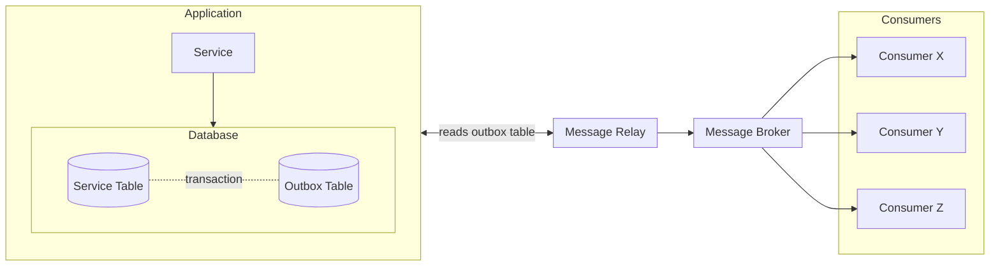

# Message Relay

Implementation of the [transactional outbox pattern](https://microservices.io/patterns/data/transactional-outbox.html) in Go.

## Architecture

## Todo List

- tests
- metrics
- health checks
- add a retry mechanism in case of a failure
- add a way to configure the number of retries
